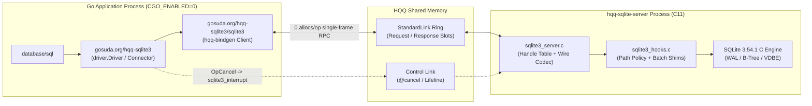

# hqq-sqlite3 (`gosuda.org/hqq-sqlite3`)

`gosuda.org/hqq-sqlite3` is a zero-`cgo` `database/sql` driver (`"hqq-sqlite"`) and isolated C11 SQLite server (`hqq-sqlite-server`) built with [`hqq-bindgen`](https://github.com/gosuda/HQQ/tree/main/bindgen) over HQQ shared-memory rings. Go applications compile with `CGO_ENABLED=0` while executing the official SQLite C amalgamation (`3.54.1`) in a dedicated worker process with generation-checked handles, batched row transfers, and TOCTOU-free binary verification.

---

## Architecture and Design Trade-Offs

Each `*sql.Conn` opens an isolated HQQ `StandardLink` shared-memory session to `hqq-sqlite-server`. The server assigns a dedicated OS thread and `sqlite3*` handle to each session, running SQLite C calls directly on the receive thread without intermediate work queues or global server locks (`@serialize(none)`).



| Property | `gosuda.org/hqq-sqlite3` | In-Process `cgo` SQLite | Transpiled C-to-Go SQLite |
| :--- | :--- | :--- | :--- |
| **Go Build & Cross-Compilation** | Pure Go (`CGO_ENABLED=0`), standard Go compiler | Requires C toolchain and `CGO_ENABLED=1` | Pure Go (`CGO_ENABLED=0`) |
| **SQLite Engine Implementation** | Official SQLite C amalgamation (`-O3`, native SIMD) | Official SQLite C amalgamation | Mechanical C-to-Go translation |
| **Fault & Memory Isolation** | C faults or corruptions terminate only `hqq-sqlite-server` | Corrupts or crashes the host Go runtime | Shares the Go process address space |
| **Orphan Transaction Cleanup** | Kernel closes `--parent-stdin` pipe on Go `SIGKILL`; server rolls back and exits | OS releases file locks; no clean connection teardown | OS releases file locks; no clean connection teardown |
| **Binary Supply-Chain Verification** | Verified before `exec` via `secureexec` (`memfd` / private vault / locked handle) | Linked at build time | Linked at build time |

---

## Quickstart

### 1. Supervised Child Server (`launcher.OpenManaged`)

Use [`gosuda.org/hqq-sqlite3/launcher`](launcher/README.md) when your Go application manages the lifecycle of `hqq-sqlite-server` directly. `OpenManaged` verifies the server binary's SHA-256 digest (or ed25519-signed release manifest) via `gosuda.org/hqq/secureexec`, attaches a `--parent-stdin` lifeline pipe, waits for the readiness handshake, and returns a connected `*sql.DB`:

```go
package main

import (
	"context"
	"fmt"
	"log"
	"runtime"
	"time"

	sqlite "gosuda.org/hqq-sqlite3"
	"gosuda.org/hqq-sqlite3/launcher"
)

func main() {
	ctx := context.Background()

	hash, ok := sqlite.ExpectedHash(runtime.GOOS, runtime.GOARCH)
	if !ok {
		log.Fatalf("no pinned server digest for %s/%s", runtime.GOOS, runtime.GOARCH)
	}

	m, err := launcher.OpenManaged(ctx, launcher.Config{
		Binary:   "/opt/hqq/bin/hqq-sqlite-server",
		SHA256:   hash,
		AllowDir: "/var/lib/myapp/db",
		Aliases:  map[string]string{"main": "/var/lib/myapp/db/app.db"},
	},
		launcher.WithDatabase("main"),
		launcher.WithSQLiteConfig(sqlite.Config{
			Timeout:     5 * time.Second,
			BusyTimeout: 5 * time.Second,
			Pragmas: map[string]string{
				"journal_mode": "WAL",
				"synchronous":  "NORMAL",
				"foreign_keys": "1",
			},
		}),
	)
	if err != nil {
		log.Fatal(err)
	}
	defer m.Close() // closes *sql.DB first, then stops hqq-sqlite-server

	var version string
	if err := m.DB.QueryRowContext(ctx, "SELECT sqlite_version()").Scan(&version); err != nil {
		log.Fatal(err)
	}
	fmt.Println("SQLite version:", version)
}
```

### 2. Connecting via `database/sql` DSN or `NewConnector`

Import `gosuda.org/hqq-sqlite3` to register the `"hqq-sqlite"` driver with `database/sql` and connect to a running `hqq-sqlite-server` listener:

```go
import (
	"database/sql"

	_ "gosuda.org/hqq-sqlite3" // registers "hqq-sqlite"
)

db, err := sql.Open(
	"hqq-sqlite",
	"hqq://sqlite-svc?db=main&_journal=WAL&_sync=NORMAL&_fk=1&_busy_timeout=5000&_txlock=immediate",
)
if err != nil {
	return err
}
defer db.Close()
```

For full documentation of the `hqq://` DSN format, standard underscore-prefixed control knobs (`_journal_mode`, `_synchronous`, `_foreign_keys`, `_busy_timeout`, `_txlock`, `_loc`, `_cache_size`, `_mmap_size`, and others), `pragma.<name>` options, and Go-to-SQLite type conversion rules, see [**`docs/DSN.md`**](docs/DSN.md).

---

## Core Mechanics and Guarantees

### Generation-Checked Handles and Automatic Teardown

Raw `sqlite3*` and `sqlite3_stmt*` pointers never cross the process boundary. `hqq-bindgen` issues 64-bit `(index: u32, generation: u32)` handles scoped to the owning session:

- **Ownership hierarchy (`@owned_by(Db)`)**: closing a `Db` handle automatically finalizes any remaining `Stmt` handles in reverse creation order before invoking `sqlite3_close`.
- **Safe close (`@retain_on_fail`)**: if `sqlite3_close` returns `SQLITE_BUSY`, the handle remains valid in the session table so the caller can inspect or recover the state.
- **Crash rollback**: if a client closes its session or terminates mid-transaction (including via `SIGKILL`), the server finalizes all statements, executes `ROLLBACK` if `sqlite3_get_autocommit(db) == 0`, and closes the connection.

### Batched Row Fetching and Oversized Cell Streaming

Naive per-row IPC over `sqlite3_step` and `sqlite3_column_*` incurs one round trip per column. `gosuda.org/hqq-sqlite3` eliminates chatty round trips with three composite C shims in [`sqlite3/server/sqlite3_hooks.c`](sqlite3/server/sqlite3_hooks.c):

1. **`exec_stmt`**: combines `sqlite3_reset`, bulk parameter binding (`bind_values`), `sqlite3_step` to completion, `sqlite3_changes64`, and `sqlite3_last_insert_rowid` into a single RPC round trip.
2. **`fetch_rows`**: steps up to `fetch` rows (default `256`, max `4096`) into a single 64 KiB response buffer (`@max_out(65536)`), reserving trailer space before each step so it never steps a row it cannot serialize.
3. **`column_chunk`**: when a row contains a `TEXT` or `BLOB` cell that exceeds the remaining space in the 64 KiB batch buffer, `fetch_rows` emits a `BigText` or `BigBlob` marker with the total byte length and pauses the cursor on that row. The Go driver then streams the cell in chunks up to 1 MiB via `column_chunk` before resuming `fetch_rows`.

### Error Semantics and Write Retry Safety

The driver maps server failures into distinct Go error types so `database/sql` retries read operations on transient link loss without ever double-executing a write whose commit status is ambiguous:

| Failure Condition | Returned Error Type / Sentinel | `database/sql` Retry Behavior |
| :--- | :--- | :--- |
| SQLite engine error (`SQLITE_BUSY`, `SQLITE_CONSTRAINT_UNIQUE`, ...) | `*sqlite.Error` (`Code`, `ExtendedCode`, `Message`); matches `ErrBusy`, `ErrLocked`, `ErrConstraint`, `ErrReadOnly`, `ErrInterrupted` | Not retried by `database/sql`; inspect via `errors.As` or `sqlite.IsBusy(err)` |
| Wire/policy refusal (multi-statement SQL, path violation, limit exceeded) | `*sqlite.ProtocolError` (`Code`, `Message`) | Not retried |
| Link lost during `Connect`, `Prepare`, `Begin`, `Query`, `Ping`, `Commit`, or `Rollback` | Wraps `driver.ErrBadConn` | `database/sql` discards the dead connection and retries on a new session |
| Link lost while `Exec` or `ExecStmt` is in flight | Wraps `sqlite.ErrOutcomeUnknown` (does **not** wrap `driver.ErrBadConn`) | Never retried automatically because the statement may have already committed |
| Caller `context.Context` expires mid-call | Sends out-of-band `@cancel(sqlite3_interrupt)`, closes the session, and returns `ctx.Err()` | Connection is discarded; server rolls back any uncommitted transaction |

---

## Measured Performance

End-to-end `database/sql` latency measured against `hqq-sqlite-server` (SQLite `3.54.1` compiled at `-O3`, Apple M1 Max):

| Workload | Latency (`hqq-sqlite`) | Notes |
| :--- | ---: | :--- |
| `SELECT 1` | `3.5 µs` | Ad-hoc query (`prepare_one` + `fetch_rows` + finalize) |
| Point `SELECT`, prepared (`*sql.Stmt`) | `3.1 µs` | Single round-trip `bind_values` + `fetch_rows` |
| `INSERT` 1,000 rows in one transaction | `1.00 ms` | `1.0 µs` per row via prepared `exec_stmt` |
| `INSERT`, autocommit (WAL) | `9.8 µs` | Includes WAL frame write |
| Scan 100,000 rows (`fetch=256`) | `19.5 ms` | `195 ns` per row across 391 batched `fetch_rows` calls |
| Scan 100,000 rows (`fetch=4096`) | `20.8 ms` | Bounded by the 64 KiB batch buffer (`~900` rows per batch) |
| `1 MiB` `BLOB` round trip | `2.02 ms` | Multi-frame bind + chunked `column_chunk` read |
| Point `SELECT`, 8 parallel connections | `4.0 µs` | Concurrent sessions executing with `@serialize(none)` |

---

## Versioning and Supply-Chain Verification

Module release tags follow `v<WrapperMajor>.<WrapperMinor>.<SQLiteVersionNumber>`:

- **`v0.1.3540100`**: Wrapper `v0.1`, SQLite `3.54.1` (`SQLITE_VERSION_NUMBER = 3540100`).
- Wrapper API or C shim changes increment `<WrapperMinor>`; upstream SQLite updates increment the trailing 7-digit normalized version integer.
- Release builds publish SLSA build provenance attestations (`actions/attest-build-provenance`) and populate per-platform SHA-256 digests in [`hashes.go`](hashes.go) (`sqlite.ExpectedHash(runtime.GOOS, runtime.GOARCH)`) for verification via `gosuda.org/hqq/secureexec`.

---

## Documentation Index

| Document | Scope |
| :--- | :--- |
| [**`docs/DSN.md`**](docs/DSN.md) | `hqq://` DSN URI syntax, connection parameters, underscore-prefixed PRAGMA control knobs (`_journal`, `_sync`, `_fk`, `_busy_timeout`, `_txlock`, `_loc`, ...), conflict rules, and Go/SQLite type mappings. |
| [**`launcher/README.md`**](launcher/README.md) | Supervised child-process launcher (`Start`, `Open`, `OpenManaged`), `secureexec` SHA-256 and ed25519 manifest verification, and `--parent-stdin` lifeline semantics. |
| [**`sqlite3/README.md`**](sqlite3/README.md) | Low-level `hqq-bindgen` IDL ([`sqlite3/sqlite3.idl`](sqlite3/sqlite3.idl)), C server hooks (`sqlite3_hooks.c`), path-policy sandboxing (`--allow-dir`, `--alias`), and low-level test suite. |
| [**`PROTOCOL.md`**](PROTOCOL.md) | Service wire contract: open-policy rules, single-statement enforcement, transaction modes, session teardown sequence, and resource limits. |
| [**`doc.go`**](doc.go) | Package-level GoDoc reference (`go doc gosuda.org/hqq-sqlite3`). |

---

## Build, Verification, and Benchmarks

Fetch the pinned SQLite amalgamation (`3.54.1`, verified against [`third_party/sqlite/SHA256`](third_party/sqlite/SHA256) and [`third_party/sqlite/SHA3-256`](third_party/sqlite/SHA3-256)), build `hqq-sqlite-server` and `sqlite3_server`, and run all unit, 107-case `database/sql` contract, and crash-recovery suites:

```bash
eval "$(sqlite3/build.sh -T)"
go test -race ./...
```

Run the `database/sql` and low-level client benchmark suites:

```bash
eval "$(sqlite3/build.sh)"
go test -run '^$' -bench . -benchtime 1s . ./sqlite3
```

Regenerate the pure-Go client and C server dispatch glue after modifying [`sqlite3/sqlite3.idl`](sqlite3/sqlite3.idl):

```bash
go generate ./...
```
