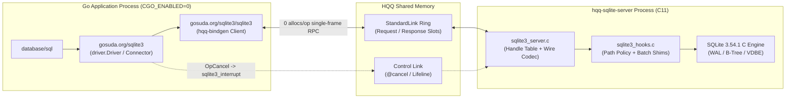

# Architecture and Internals (`gosuda.org/sqlite3`)

This document describes the internal execution model, shared-memory IPC layout, handle table guarantees, batching shims, error retry classification, and benchmark results of `gosuda.org/sqlite3`.

---

## 1. Execution Model and Trade-Offs

Each `*sql.Conn` opens an isolated HQQ `StandardLink` shared-memory session to `hqq-sqlite-server`. The server assigns a dedicated OS thread and `sqlite3*` handle to each session, running SQLite C calls directly on the receive thread without intermediate work queues or global server locks (`@serialize(none)`).



| Property | `gosuda.org/sqlite3` | In-Process `cgo` SQLite | Transpiled C-to-Go SQLite |
| :--- | :--- | :--- | :--- |
| **Go Build & Cross-Compilation** | Pure Go (`CGO_ENABLED=0`), standard Go compiler | Requires C toolchain and `CGO_ENABLED=1` | Pure Go (`CGO_ENABLED=0`) |
| **SQLite Engine Implementation** | Official SQLite C amalgamation (`-O3`, native SIMD) | Official SQLite C amalgamation | Mechanical C-to-Go translation |
| **Fault & Memory Isolation** | C faults or corruptions terminate only `hqq-sqlite-server` | Corrupts or crashes the host Go runtime | Shares the Go process address space |
| **Orphan Transaction Cleanup** | Kernel closes `--parent-stdin` pipe on Go `SIGKILL`; server rolls back and exits | OS releases file locks; no clean connection teardown | OS releases file locks; no clean connection teardown |
| **Binary Supply-Chain Verification** | Verified before `exec` via `secureexec` (`memfd` / private vault / locked handle) | Linked at build time | Linked at build time |

---

## 2. Generation-Checked Handles and Automatic Teardown

Raw `sqlite3*` and `sqlite3_stmt*` pointers never cross the process boundary. `hqq-bindgen` issues 64-bit `(index: u32, generation: u32)` handles scoped to the owning session:

- **Ownership hierarchy (`@owned_by(Db)`)**: closing a `Db` handle automatically finalizes any remaining `Stmt` handles in reverse creation order before invoking `sqlite3_close`.
- **Safe close (`@retain_on_fail`)**: if `sqlite3_close` returns `SQLITE_BUSY`, the handle remains valid in the session table so the caller can inspect or recover the state.
- **Crash rollback**: if a client closes its session or terminates mid-transaction (including via `SIGKILL`), the server finalizes all statements, executes `ROLLBACK` if `sqlite3_get_autocommit(db) == 0`, and closes the connection.

---

## 3. Batched Row Fetching and Oversized Cell Streaming

Naive per-row IPC over `sqlite3_step` and `sqlite3_column_*` incurs one round trip per column. `gosuda.org/sqlite3` eliminates chatty round trips with three composite C shims in [`../sqlite3/server/sqlite3_hooks.c`](../sqlite3/server/sqlite3_hooks.c):

1. **`exec_stmt`**: combines `sqlite3_reset`, bulk parameter binding (`bind_values`), `sqlite3_step` to completion, `sqlite3_changes64`, and `sqlite3_last_insert_rowid` into a single RPC round trip.
2. **`fetch_rows`**: steps up to `fetch` rows (default `256`, max `4096`) into a single 64 KiB response buffer (`@max_out(65536)`), reserving trailer space before each step so it never steps a row it cannot serialize.
3. **`column_chunk`**: when a row contains a `TEXT` or `BLOB` cell that exceeds the remaining space in the 64 KiB batch buffer, `fetch_rows` emits a `BigText` or `BigBlob` marker with the total byte length and pauses the cursor on that row. The Go driver then streams the cell in chunks up to 1 MiB via `column_chunk` before resuming `fetch_rows`.

---

## 4. Error Classification and Write Retry Safety

The driver maps server failures into distinct Go error types so `database/sql` retries read operations on transient link loss without ever double-executing a write whose commit status is ambiguous:

| Failure Condition | Returned Error Type / Sentinel | `database/sql` Retry Behavior |
| :--- | :--- | :--- |
| SQLite engine error (`SQLITE_BUSY`, `SQLITE_CONSTRAINT_UNIQUE`, ...) | `*sqlite.Error` (`Code`, `ExtendedCode`, `Message`); matches `ErrBusy`, `ErrLocked`, `ErrConstraint`, `ErrReadOnly`, `ErrInterrupted` | Not retried by `database/sql`; inspect via `errors.As` or `sqlite.IsBusy(err)` |
| Wire/policy refusal (multi-statement SQL, path violation, limit exceeded) | `*sqlite.ProtocolError` (`Code`, `Message`) | Not retried |
| Link lost during `Connect`, `Prepare`, `Begin`, `Query`, `Ping`, `Commit`, or `Rollback` | Wraps `driver.ErrBadConn` | `database/sql` discards the dead connection and retries on a new session |
| Link lost while `Exec` or `ExecStmt` is in flight | Wraps `sqlite.ErrOutcomeUnknown` (does **not** wrap `driver.ErrBadConn`) | Never retried automatically because the statement may have already committed |
| Caller `context.Context` expires mid-call | Sends out-of-band `@cancel(sqlite3_interrupt)`, closes the session, and returns `ctx.Err()` | Connection is discarded; server rolls back any uncommitted transaction |

---

## 5. Measured Performance

End-to-end `database/sql` latency measured against `hqq-sqlite-server` (SQLite `3.54.1` compiled at `-O3`, Apple M1 Max):

| Workload | Latency (`hqq-sqlite`) | Notes |
| :--- | ---: | :--- |
| `SELECT 1` | `3.5 µs` | Ad-hoc query (`prepare_one` + `fetch_rows` + finalize) |
| Point `SELECT`, prepared (`*sql.Stmt`) | `3.1 µs` | Single round-trip `bind_values` + `fetch_rows` |
| `INSERT` 1,000 rows in one transaction | `1.00 ms` | `1.0 µs` per row via prepared `exec_stmt` |
| `INSERT`, autocommit (WAL) | `9.8 µs` | Includes WAL frame write |
| Scan 100,000 rows (`fetch=256`) | `19.5 ms` | `195 ns` per row across 391 batched `fetch_rows` calls |
| Scan 100,000 rows (`fetch=4096`) | `20.8 ms` | Bounded by the 64 KiB batch buffer (`~900` rows per batch) |
| `1 MiB` `BLOB` round trip | `2.02 ms` | Multi-frame bind + chunked `column_chunk` read |
| Point `SELECT`, 8 parallel connections | `4.0 µs` | Concurrent sessions executing with `@serialize(none)` |

---

## 6. Versioning and Build Commands

Module release tags follow `v<WrapperMajor>.<WrapperMinor>.<SQLiteVersionNumber>`:

- **`v0.3.3540100`**: Wrapper `v0.3`, SQLite `3.54.1` (`SQLITE_VERSION_NUMBER = 3540100`).
- Release builds publish SLSA build provenance attestations (`actions/attest-build-provenance`) and pin per-platform SHA-256 digests in [`../hashes.go`](../hashes.go).

Build `hqq-sqlite-server` and run the full test and benchmark suites from the repository root:

```bash
eval "$(sqlite3/build.sh -T)"
go test -p 1 -race ./...
go test -run '^$' -bench . -benchtime 1s . ./sqlite3
```
